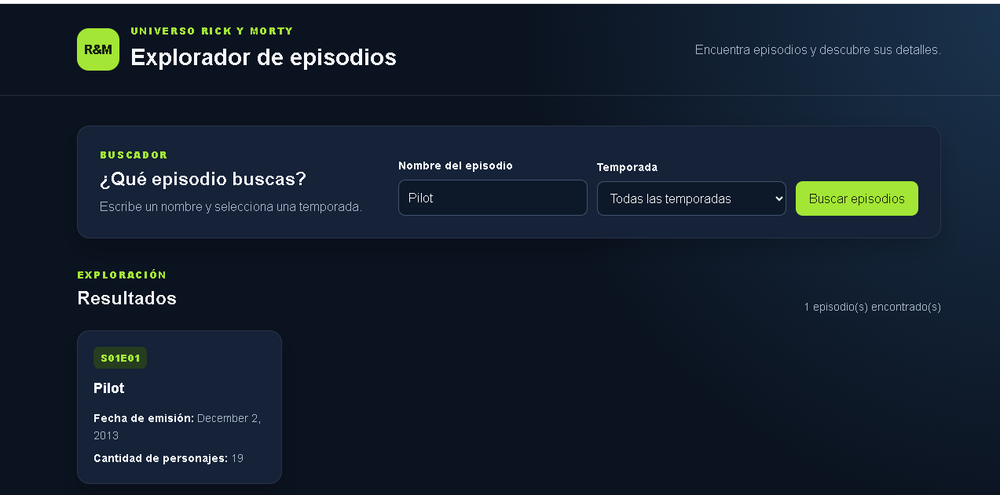

# Explorador de episodios de Rick y Morty

**Estudiante:** Janice Jazmín Fernández Chávez  
**Variante:** C – Episodios (último dígito de cédula: 8)  
**Asignatura:** Fundamentos de Desarrollo Web – Ingeniería en Informática

## Descripción
Aplicación web de una sola pantalla que permite buscar episodios de Rick y Morty mediante la API REST pública. La búsqueda puede realizarse por nombre y por temporada. Los resultados se presentan en tarjetas con el nombre, código, fecha de emisión y cantidad de personajes.

## Tecnologías utilizadas
- HTML5 semántico
- CSS3 (Grid, Flexbox, variables y diseño responsive)
- JavaScript ES6+ (Fetch, async/await, DOM y localStorage)
- API: https://rickandmortyapi.com/documentation

## Cómo ejecutar
Abre `index.html` en un navegador. Se necesita conexión a internet para consultar la API.

## Captura de pantalla

